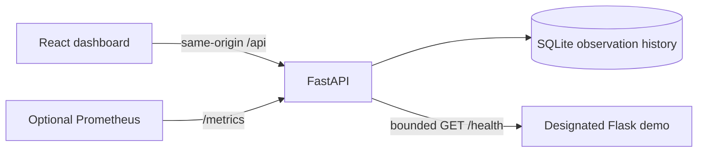

# FailureVerse AI

**Autonomous Infrastructure Failure Prediction, Simulation & Recovery Intelligence Platform**

A research project for the **AI for Future Workforce Agentic AI Bootcamp 2026**. Infrastructure incidents often require an engineer to gather scattered evidence, form hypotheses, compare recovery options, and verify results. FailureVerse aims to make that process observable and reproducible through specialized agents and isolated experiments.

**Current scope: Phase 1 foundation.** The application runs real service health checks and saves observations. AI investigation, prediction, fault injection, and recovery are not implemented or represented as active features. No paid API is required.

## Implemented foundation

- FastAPI with validated settings, OpenAPI documentation, SQLite via SQLAlchemy, readiness, and Prometheus request counters.
- React, Vite, TypeScript, Tailwind CSS, Recharts, and Lucide dashboard with overview, service evidence, expandable check history, JSON export, and read-only configuration.
- Actual SQLite query latency and Flask HTTP health-check latency. Failed measurements remain missing; no invented CPU, RAM, incident, or AI statistics.
- Fixed local diagnostic targets, response-size and time limits, bounded history, explicit API failures, restricted browser origins, and secret-free public configuration.
- Dockerized Flask test app; resource-limited Compose services; optional Prometheus profile.
- Pytest, Vitest, React Testing Library, and a real Flask HTTP → FastAPI → SQLite integration test. Initial GitHub Actions verification workflow; no deployment or publishing workflow.

See [Phase 1 verification report](docs/phase-1-report.md) for executed checks and limits. Source code being present does not mean the corresponding environment or external workflow has been verified.

The Phase 1 automated suites contain **53 tests**: 38 backend, 3 Flask demo, and 12 frontend tests. The production build, container builds, and a live frontend-to-backend-to-Flask/SQLite smoke check are part of the milestone verification. Browser layout review, the optional Prometheus profile, and execution of the workflow on GitHub are separate checks; see the report for their status.

## Architecture



Phase 1 has no LLM calls, container-control tools, arbitrary shell endpoints, or infrastructure mutations. The future LangGraph architecture and six agent responsibilities are documented in [architecture.md](docs/architecture.md).

## Requirements

| Tool | Requirement | Purpose |
| --- | --- | --- |
| Python | 3.11+, tested with 3.12 | Backend, demo, Pytest |
| Node.js | 22.12+; use an even-numbered supported release | Vite, Vitest, production build |
| npm | Bundled with Node.js | Locked frontend dependencies |
| Docker Desktop + Compose | Linux containers / WSL2 on Windows | Container builds and local demonstration |
| Git | Any supported version | Version control |
| Ollama | Not needed in Phase 1 | Local LLM in Phase 2 |

If missing on Windows:

```powershell
winget install --exact --id Python.Python.3.12 --scope user
winget install --exact --id OpenJS.NodeJS.LTS
winget install --exact --id Docker.DockerDesktop
winget install --exact --id Git.Git
wsl --install -d Ubuntu
```

Restart the terminal after installation. Enable Docker Desktop's WSL2 engine and Linux containers. Do not install or enable anything already available.

## Run with Docker

From the repository root:

```powershell
if (-not (Test-Path .env)) { Copy-Item .env.example .env }
docker compose config --quiet
docker compose up --build --wait
```

On Linux/macOS use `test -f .env || cp .env.example .env`. Preserve an existing `.env` and its settings. These commands start a **local test demonstration**, not a production deployment.

| Service | Local address |
| --- | --- |
| Dashboard | http://localhost:8080 |
| Backend readiness | http://localhost:8000/api/health |
| API documentation | http://localhost:8000/docs |
| Flask demo health | http://localhost:5001/health |
| Optional Prometheus | http://localhost:9090 |

Run another check in the dashboard to collect a second latency sample. Open **Health-check history** to inspect each observation or export JSON. Start optional metrics collection with `docker compose --profile observability up --build --wait`.

Stop the local stack with `docker compose down`. This preserves the SQLite volume. Never add `--volumes` unless you intend to delete the saved observations. Local services occupy ports 5001, 8000, and 8080; stop conflicting development servers first.

## Run without containers

Create the environment and install dependencies at the repository root:

```powershell
if (-not (Test-Path .env)) { Copy-Item .env.example .env }
py -3.12 -m venv .venv
& ./.venv/Scripts/python.exe -m pip install -r backend/requirements-dev.txt
Set-Location frontend
npm.cmd ci
```

If you use `uv` and have no Python installed, an entirely workspace-local alternative is:

```powershell
$env:UV_CACHE_DIR = Join-Path (Get-Location) '.cache/uv'
$env:UV_PYTHON_INSTALL_DIR = Join-Path (Get-Location) '.tools/python'
uv python install 3.12
uv venv --python 3.12 .venv
uv pip install --python .venv/Scripts/python.exe -r backend/requirements-dev.txt
```

Run each service in a separate terminal:

```powershell
# Terminal 1, repository root
& ./.venv/Scripts/python.exe demo-app/app.py

# Terminal 2, repository root
Set-Location backend
& ../.venv/Scripts/python.exe -m uvicorn app.main:app --host 127.0.0.1 --port 8000 --reload

# Terminal 3, repository root
Set-Location frontend
npm.cmd run dev
```

Open http://localhost:5173. Vite proxies `/api` to port 8000. The Flask development server is for local use only; the Docker image uses Gunicorn. On Linux/macOS replace `.venv/Scripts/python.exe` with `.venv/bin/python` and `npm.cmd` with `npm`.

## Configuration

Settings use the `FV_` prefix and are validated at startup. The backend reads the root `.env` when started from `backend/`. Database paths are relative to the backend working directory; the default is `backend/data/failureverse.db`. Compose explicitly selects its own persistent `/app/data` location and Docker service hostname.

| Variable | Default / meaning |
| --- | --- |
| `FV_ENVIRONMENT` | `development`, `test`, or `demo` |
| `FV_DATABASE_URL` | `sqlite:///./data/failureverse.db`; Phase 1 accepts SQLite only |
| `FV_DEMO_HEALTH_URL` | `http://127.0.0.1:5001/health`; only localhost or `demo-app` and `/health` accepted |
| `FV_ALLOWED_ORIGINS` | JSON array of local frontend origins |
| `FV_CHECK_TIMEOUT_SECONDS` | `2`; bounded to 0.1–10 seconds |
| `FV_HISTORY_LIMIT` | `120`; retained observation count, bounded to 10–1000 |
| `FV_OLLAMA_MODEL` | Reserved model name; no inference in Phase 1 |
| `FV_CLOUD_API_KEY` | Reserved secret; optional, unused, never exposed by the API |

The Configuration screen is read-only. Edit environment values and restart the backend to apply changes. Keep `.env`, database files, runtime caches, and credentials out of Git. PostgreSQL requires migrations and driver support in a later phase; changing the URL alone is not supported.

## API

| Method | Path | Behavior |
| --- | --- | --- |
| GET | `/api/health` | Live API/database readiness; HTTP 503 if database unavailable |
| GET | `/api/overview` | Latest saved observations and up to 30 recent checks |
| GET | `/api/checks?limit=30` | Newest checks first; limit 1–120 |
| POST | `/api/checks` | `{"source":"manual"}`; runs and persists a read-only check |
| GET | `/api/config` | Public environment/provider configuration; no keys |
| GET | `/metrics` | Real API request counters in Prometheus format |
| GET | `/docs` | Interactive API documentation |
| GET | `/openapi.json` | Machine-readable API schema |

The backend performs one startup check. New measurements are collected only when explicitly requested; refreshing the dashboard retrieves saved data every 15 seconds. A healthy readiness endpoint does not imply the optional Flask target is healthy. The UI always labels the last observation timestamp. Health history is not an incident history or a permanent security audit log.

Docker's Python health probes skip optional interpreter startup initialization and allow 10 seconds for the complete probe process on a busy development host. Each probe's HTTP request still has a 2-second timeout. Application diagnostic requests remain bounded by `FV_CHECK_TIMEOUT_SECONDS`.

## Tests and build

```powershell
# From backend/
& ../.venv/Scripts/python.exe -m pytest -q

# From demo-app/
& ../.venv/Scripts/python.exe -m pytest -q

# From frontend/
npm.cmd test
npm.cmd run build

# From repository root; requires running services
& ./.venv/Scripts/python.exe scripts/smoke.py --frontend http://127.0.0.1:5173

# Validate container configuration and build images without starting services
docker compose config --quiet
docker compose build
```

Backend dev dependencies include Flask so the integration test makes a real HTTP request to the actual demo app using an ephemeral local port and temporary SQLite database. Other network failures use isolated test transports. Vitest uses fixtures only inside `src/test/`; the application has no mock-data mode. Browser layout verification is separate from jsdom tests.

## Safety boundaries and limitations

- Local demonstration only: no authentication or multi-user authorization is implemented. Keep ports bound to loopback; do not expose the application publicly.
- Git and Docker build exclusions cover `.env` files, private keys, credential directories, local AWS/SSH files, databases, and runtime caches. Only the empty-secret `.env.example` belongs in version control.
- Demo containers have explicit project/test labels, resource limits, dropped capabilities, non-root users, and an internal test network. The frontend has no path to the Docker socket.
- Phase 1 exposes no recovery, shell, failure injection, or container-control endpoint. Emergency stop and approval enforcement must be implemented and tested before any such tool is added.
- No production target is accepted by the health-check configuration. HTTP redirects are not followed; network proxy environment variables are ignored for demo checks.
- Retention deletes older service observations. Future agent audit records need separate retention and integrity policies.
- No prediction accuracy, uptime percentage, AI reasoning, or simulated recovery results are claimed in this phase.

## Roadmap and phase gates

1. **Foundation:** complete the test and review gate documented in [Phase 1 report](docs/phase-1-report.md).
2. **First AI agent:** Ollama, validated tool selection, read-only Docker inspection of labeled test containers, structured evidence and uncertainty.
3. **Multi-agent orchestration:** LangGraph state transitions, bounded retries, monitoring, investigation, simulation planning, risk analysis, and recovery planning.
4. **Failure experiments:** isolated reversible fault scenarios, comparative recovery evaluation, approval-bound allowlisted execution, emergency stop, and verification.
5. **Dashboard integration:** live agent events, incident workflows, approval controls, execution timeline, and incident history.
6. **Evaluation and deployment:** broader integration/safety tests, CI/CD, approved deployment, demo recording, screenshots, presentation, and bootcamp evaluation evidence.

Do not advance phases until the preceding implementation is tested and reviewed. Ask before committing, pushing, or deploying. No paid provider is needed for the local MVP.

## Project layout

```text
frontend/src/                 React pages, reusable components, typed API, UI tests
backend/app/api/              Validated endpoint contracts
backend/app/core/             Environment and database configuration
backend/app/models/           Persistent health-check schema
backend/app/services/         Fixed-target read-only diagnostics
backend/tests/                Unit, API, persistence, and real HTTP integration tests
demo-app/                     Flask test application, Dockerfile, tests
infrastructure/docker/        Backend/frontend images and reverse proxy
infrastructure/monitoring/    Optional Prometheus scrape configuration
scripts/                      Local verification tools
docs/                         Architecture, verification, demo and phase guidance
.github/workflows/            Initial test/build verification workflow
```

Agent, tool-gateway, monitoring-agent, and simulation modules will be added when their implementation begins. Empty modules are not used to imply completed functionality.

Design guidance acknowledgement: [unslop by Damir Sokolovsky](https://heydamir.design/unslop), CC BY 4.0. The dashboard uses the project’s own components, actual evidence, and locally bundled IBM Plex fonts.
