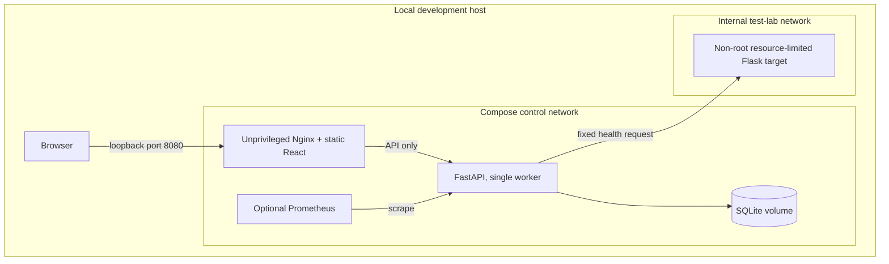
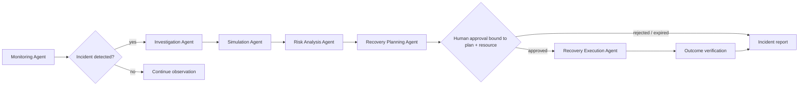

# Architecture and phase boundaries

## Running Phase 1

The React dashboard fetches typed JSON contracts from FastAPI. Vite proxies API calls during development; Nginx proxies them in the local Compose stack. The browser never contacts Docker, SQLite, or the demo service directly.

FastAPI owns a SQLAlchemy engine and a read-only `HealthService`. Application lifespan initializes the schema, performs one bounded startup check, and closes the engine on shutdown. A manual check observes API readiness, times a real SQLite `SELECT 1`, requests the configured Flask health endpoint, validates its identity and status, and commits a single snapshot transaction. A process-local lock rejects concurrent checks with HTTP 409. Phase 1 intentionally runs one API worker.

The HTTP request has both a client timeout and an outer wall-clock timeout. Responses are limited to 8 KiB, redirects are not followed, environment proxies are ignored, and callers cannot choose targets, paths, actions, or shell commands. Configuration permits only localhost / `demo-app` and `/health`. These are health observations, not container inspection or AI investigation.

Saved snapshots have a UUID, UTC timestamp, source, and individual service observations, each labeled `actual`. Failed connections have no latency value; HTTP failure responses can have measured latency. API liveness has no invented timing. The latest observations can be stale and are displayed with their collection timestamp. The 15-second frontend refresh reads history; it does not collect new samples.

SQLite retention is bounded to the configured count. Startup checks also count toward retention. Data survives backend restarts using a local file or Compose volume. PostgreSQL support will require explicit driver, migration, and concurrency work. The initial schema uses `create_all`; use reviewed migrations before schema evolution.

## Trust boundaries

The backend joins both networks, but no Docker socket is mounted. The demo cannot route to external services through its internal network. All published ports bind to loopback. No authentication is included, so this is not a public service. The Phase 1 request counters are observational metrics only, not host/container CPU or memory metrics.

## Planned agent architecture — not implemented

LangGraph will coordinate a shared validated incident state, persist recoverable checkpoints, and use conditional routing. Private chain-of-thought will never be requested or stored; concise decision summaries and tool evidence will be recorded.

| Agent | Planned responsibility | Planned tools and boundaries |
| --- | --- | --- |
| Monitoring | Collect actual container health, CPU, RAM; apply configurable detection rules | Read-only labeled-container metrics; bounded poll and retry limits |
| Investigation | Choose diagnostics, examine logs, identify hypotheses with evidence and uncertainty | Validated read-only status/log tools; tool-call budget; prompt-injection resistant treatment of logs |
| Simulation | Generate and test a falsifiable failure scenario | Dedicated project-owned lab resources; fixed fault catalog, limits, automatic rollback |
| Risk analysis | Estimate severity, dependencies, strategy effectiveness and uncertainty | Evidence-based comparisons; estimated quantities explicitly labeled |
| Recovery planning | Produce alternative step-by-step plans with operational risk and cost | Validated plan schema, fixed action names, immutable plan/resource identity |
| Recovery execution | Apply exactly approved allowlisted operations and verify outcomes | Backend gateway only; expiring approval; label revalidation; bounded execution; emergency stop |

Before any mutation tools exist, implement policy checks that verify project/test labels immediately before every operation, explicit approval bound to exact plan/resource/action identifiers, expiry and replay prevention, and an emergency-stop latch. Never allow generated shell commands or expose the Docker socket to the model or frontend. Docker access is privileged even when calls are logically restricted; evaluate a socket proxy or separated worker at that phase.

Start with a genuine Ollama investigation agent in Phase 2. It must use model-selected structured tool calls and actual evidence. If Ollama is unavailable, return an explicit unavailable state. Do not fall back to canned AI reports. Cloud inference is optional later and must not become an MVP requirement.

## Phase gates

Each phase must pass relevant unit, integration, contract, and safety tests before progressing. Persist decision summaries, tool names and arguments, evidence identifiers, observations, transitions, approvals, outcomes, and bounded failures once agent execution exists. Test transports and fixtures must stay confined to tests.
