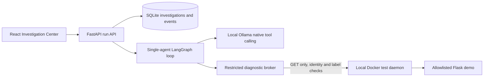

# Phase 2 / 2.1: genuine local investigation

Phase 2 implements one model-directed LangGraph investigation agent. Phase 2.1 hardens its existing tool/report loop with source-field validation, deterministic quantities and required observation coverage. Multi-agent coordination, fault injection, recovery execution, and PostgreSQL remain future work. See the [verification history](phase-2-report.md), [Phase 2.1 results](phase-2-1-report.md), and [evaluation definitions](testing.md). Scripted test transports do not count as a real AI demonstration.

## Run locally

On this development machine the CPU runtime is installed at `.tools/ollama/ollama.exe`, and models are stored in `.tools/ollama-models`. Both locations are excluded from Git and Docker build contexts. The runtime is Ollama 0.40.16, using CPU files from its official Windows release; GPU libraries were omitted because this machine has Intel HD 520 graphics and limited free disk space.

On another Windows machine, the standard installation commands are:

```powershell
winget install --exact --id Ollama.Ollama --scope user
# Restart the terminal after installation. The standard installer needs several GB of disk space.
ollama pull qwen3:0.6b
```

For the workspace-local runtime used here, start the server in a separate terminal:

```powershell
./scripts/start-ollama.ps1
```

If the model is not downloaded, use another terminal:

```powershell
& ./.tools/ollama/ollama.exe pull qwen3:0.6b
```

If Ollama is already running on port 11434, reuse it; do not start a second server. The helper keeps one model loaded at a time and binds only to localhost. The application uses a 2048-token context and two CPU inference threads. The 0.6B model is chosen for this 8 GB RAM / four-logical-CPU machine, not as a claim of high diagnostic accuracy. Larger tool-capable models can be selected through `FV_OLLAMA_MODEL` when resources permit.

From the project root:

```powershell
if (-not (Test-Path .env)) { Copy-Item .env.example .env }
docker compose up --build --wait --wait-timeout 180
```

Open `http://localhost:8080`, select **AI Investigation Center**, and wait for **Model ready**. Enter an investigation question and select **Start investigation**. The page polls persisted progress, shows native tool selections and actual observations, and displays a report only after validation succeeds. Expand collected evidence to inspect its source data. **Cancel investigation** cancels the current run; **Export JSON** downloads its full sanitized record.

The web backend reaches Windows Ollama through `host.docker.internal:11434`. Native backend development uses `FV_OLLAMA_BASE_URL=http://127.0.0.1:11434` and requires a separately reachable diagnostic broker at `FV_DIAGNOSTICS_BASE_URL`. In this Docker Desktop setup, services attached only to an internal network do not publish their configured host ports: the broker works through `diagnostics:8020` inside Compose, while `localhost:8020` is unavailable. The fully verified AI path uses the Compose backend. Native health monitoring remains available without the broker. On a Linux host, ensure the backend can reach the local Ollama service and set the diagnostic socket group correctly; that platform-specific setup is not implied to have been tested here. Do not expose an unauthenticated Ollama service to a public network.

## Architecture and privileges



Only the separate broker receives the Docker socket. Its network is internal, its configured host binding is loopback (subject to the internal-network limitation above), and it runs as a non-root user with the socket's group (`FV_DOCKER_GID`, default `0` for Docker Desktop). The web backend and frontend have no socket mount. A read-only socket filesystem mount is **not** Docker API authorization: the broker additionally rejects every non-GET HTTP method and every Docker path except version metadata and JSON/logs/stats for registered container references.

The fixed target alias `demo` resolves to `failureverse-ai-demo-app-1`. Before every tool operation, the broker inspects that exact name and requires all three labels:

```text
io.failureverse.project=failureverse-ai
io.failureverse.environment=test
io.failureverse.role=demo
```

The inspected name and 64-character container ID must also match. Only then can logs or stats be read by that ID. Environment variables, host mounts, filesystem archives, arbitrary URLs, shell execution, container creation, start/stop/restart, and deletion are not available as tools. Raw Docker inspection results never reach the model or browser.

## Agent flow and limits

The available native tools have empty, strict argument schemas: `inspect_container`, `container_logs`, `container_stats`, and `service_health`. The first three use the restricted Docker broker. Service health performs fixed HTTP and local SELECT 1 probes in the API process and gives each returned observation a separate evidence ID.

Deterministic question-coverage rules make relevant missing tools available to the model: for example, a demo-health question requires inspection and service probes; a memory question requires statistics. The model must still issue native calls. No required tool is silently executed as a scripted fallback. The graph requests reporting once at least two distinct tools and required coverage succeed; otherwise it follows up within the existing budget and returns insufficient evidence if coverage remains incomplete.

Logs remain bounded to 40 recent lines and 4096 bytes, redacted before storage and treated as untrusted data. Only an 800-character excerpt enters diagnostic-selection prompts. Raw log text does not become free-form report claims. Statistics expose actual counters; Python derives MiB and memory percentage from valid byte usage/limit pairs. CPU utilization requires interval samples and remains unavailable; disk usage is not collected. Missing and inconsistent measurements are withheld instead of invented.

The broker's `/health` endpoint checks process liveness without accessing Docker or taking its single diagnostic slot. Actual tool requests still validate container identity and labels on every operation; a healthy broker process does not prove Docker or its target is available. Invalid tool arguments and gateway failures produce distinct, sanitized feedback so the model can choose a correction within its existing budget.

LangGraph conditionally routes between model selection, diagnostic execution, and structured reporting. Each run has hard ceilings of **four inference calls**, **six attempted diagnostic tool calls**, and **180 seconds**, including provider preflight. Each inference has a configurable timeout of 120 seconds by default; the overall deadline can cancel it sooner. Metadata requests to Ollama's model listing/show endpoints are not inference calls. Provider failures during tool selection have at most one retry, which consumes the inference budget. One inference call is reserved for reporting; a report repair can use another only if budget remains. All diagnostic attempts, including invalid arguments or failures, consume the tool budget.

The report-stage model uses a compact Pydantic `ReportSelection` schema containing only supported fact, hypothesis and recommendation IDs. Python creates eligible findings from exact collected fields, computes quantities independently, binds citations, and renders an `InvestigationReport`. Arbitrary model-generated factual text, quantities, unknown IDs, wrong categories and duplicate selections are rejected. Required source observations and observed failure signals must be selected; the model cannot omit the main finding and still claim a completed conclusion. The bounded repair attempt receives specific validation feedback.

Evidence IDs contain a per-investigation UUID namespace. A separately cited coverage record explains unmeasured fields and missing tools. Summaries, uncertainties, limitations, hypotheses and recommendations are validated as well as observations. Eligible hypotheses are explicitly tentative and conditional on observed failure evidence; the 90% memory-review threshold is a diagnostic policy, not proof of a leak. Recommendations are not executed.

If selection validation fails or evidence coverage is insufficient, the terminal result is `insufficient_evidence`: source-validated observations may be retained, but they are explicitly identified as verifier output with no accepted model conclusion. Provider failure, cancellation, deadline expiry and storage failures retain their visible error states. Historical free-form Phase 2 reports remain unchanged and carry an unverified-output warning; they do not inherit the newer validation guarantees.

This deliberately bounded finding vocabulary prevents the reproduced unsupported claims. It is not proof of unrestricted causal reasoning, arbitrary log interpretation, underlying sensor correctness or future reliability.

SQLite stores concise state transitions, selected tools, timestamps, bounded observations, counters, errors, and final reports. Private model thinking and complete prompt conversations are not persisted. Ollama thinking and external LangSmith tracing are disabled for the workflow. A single API worker and a unique active-run slot enforce one investigation at a time. Cancellation, deadline expiry, provider failures, and backend restarts preserve partial evidence and explicit terminal states. Interrupted work is not silently resumed or granted a fresh hidden budget.

## Transport follow-up

The 15 November browser checks found transient preflight failures, gateway timeouts and a lost creation response. Preflight now retries `unavailable` once within the same 180-second deadline; missing/unsupported models do not retry. The broker remains limited to 7 seconds, while its client allows an 8-second read inside a 9-second overall ceiling so the caller does not abandon a legitimate bounded result prematurely. Timeouts, connection failures and invalid JSON have distinct sanitized messages. Docker restrictions and model/tool limits are unchanged.

The dashboard can follow the actual active run after a lost creation response, and start/cancel errors remain visible across polling. Actual Edge navigation, downloads, citations, cancellation, insufficient-evidence rendering and viewport layouts are verified separately from component tests. See the [browser follow-up report](phase-2-1-browser-report.md) and [reproduction commands](testing.md).

## API

| Method | Path | Behavior |
| --- | --- | --- |
| GET | `/api/ai/status` | Actual Ollama model availability and native tool capability; active run ID and limits |
| POST | `/api/investigations` | `{"target":"demo","question":"Investigate current health"}`; returns 202 and a run ID |
| GET | `/api/investigations?limit=20` | Saved run summaries; limit 1–50 |
| GET | `/api/investigations/{id}` | Full progress, events, evidence, counters, report or error |
| POST | `/api/investigations/{id}/cancel` | Cancel the active run; never modifies a container |

Browser mutations require a configured origin. The local application has no multi-user authentication and must remain bound to loopback. AI enablement is configuration; **Model ready** additionally requires a reachable installed model that advertises native tool support.

## Verification

```powershell
# backend/
& ../.venv/Scripts/python.exe -m pytest -q
# demo-app/
& ../.venv/Scripts/python.exe -m pytest -q
# frontend/
npm.cmd test
npm.cmd run build
# project root; requires the real local model and Docker services
& ./.venv/Scripts/python.exe scripts/smoke.py
& ./.venv/Scripts/python.exe scripts/verify_agent.py
```

`verify_agent.py` calls the real API and requires a completed source-field validated report with actual observations, accepted model selection and valid budgets. It reconstructs the catalog and revalidates the persisted result. It saves latest and run-specific records under ignored `artifacts/phase21/`, including failed/insufficient attempts. The application has no production mock mode. Separate evaluation fixtures explicitly identify simulated tools and either scripted or actual Ollama inference; see [testing.md](testing.md).

References: [Ollama tool calling](https://docs.ollama.com/capabilities/tool-calling), [structured outputs](https://docs.ollama.com/capabilities/structured-outputs), [Qwen3 0.6B](https://ollama.com/library/qwen3:0.6b), [LangGraph loop](https://docs.langchain.com/oss/python/langgraph/quickstart), [Docker SDK](https://docker-py.readthedocs.io/en/stable/containers.html).
